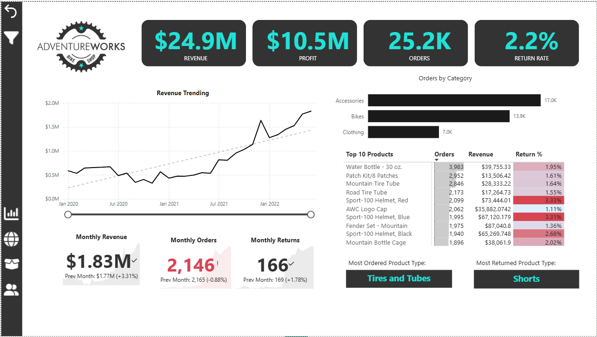
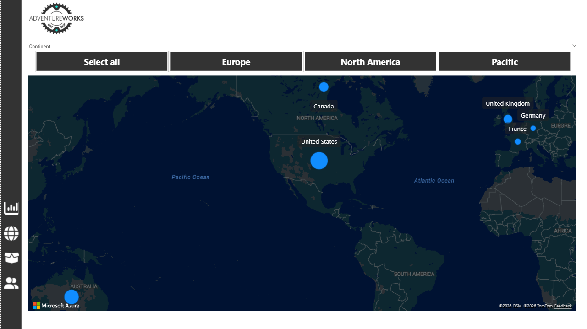
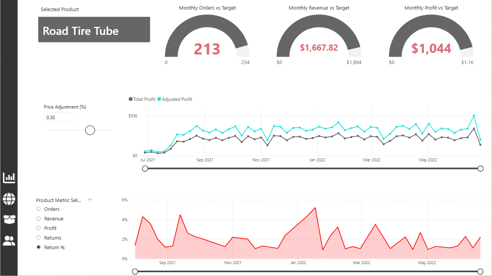
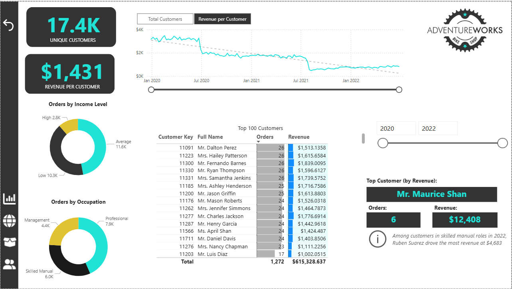

# AdventureWorks — Sales, Product & Customer Performance Analytics

**Power BI | Power Query | DAX | Data Modelling | Business Intelligence**

## Project Overview

This project analyses AdventureWorks sales, customer, product and returns data across 2020–2022 to assess revenue growth, profitability, purchasing behaviour, product performance and geographical sales patterns.

An interactive Power BI report was developed using CSV datasets imported directly into Power BI, transformed with Power Query, modelled through table relationships and analysed using DAX measures.

The objective was to translate transactional data into actionable recommendations for revenue growth, customer segmentation, product strategy and returns management.

## Executive KPIs

| Metric | Result |
|---|---:|
| Total Revenue | $24.9M |
| Total Profit | $10.5M |
| Profit Margin | Approximately 42% |
| Total Orders | 25.2K |
| Unique Purchasing Customers | 17.4K |
| Revenue per Customer | $1,431 |
| Return Rate | 2.2% |

*Figures are rounded for presentation. Profit is based on sales revenue less product cost, not net profit after all operating expenses.*

## Business Questions

1. How have revenue, orders and profitability changed over time?
2. Which products and categories contribute most to sales activity?
3. Which products have unusually high return rates?
4. How do customer income and occupation relate to purchasing behaviour?
5. How does sales activity vary geographically?
6. How do product results and pricing scenarios compare with targets?

## Tools and Methodology

- **Power BI Desktop:** Interactive dashboards, slicers and KPI cards
- **Power Query:** CSV data preparation and transformation
- **Data Modelling:** Relationships across sales, products, customers, territories, calendar and returns
- **DAX:** Revenue, profit, orders, returns, customer KPIs and what-if analysis
- **PowerPoint:** Analytical storytelling and business recommendations

### Data Workflow

CSV Sources → Power Query → Data Model → DAX Measures → Power BI Dashboards → Business Insights

## Dashboard Gallery

### 1. Executive Dashboard

Revenue, profit, orders, returns, trends and product performance.

### 2. Geographical Sales Map

Sales distribution across six countries and three continental groupings.

### 3. Product Detail

Product targets, performance metrics, returns and pricing scenarios.

### 4. Customer Detail

Customer segmentation, revenue per customer and leading customers.

## Key Business Findings

### Revenue Growth

Monthly revenue rose from approximately $0.58M in January 2020 to $1.83M in June 2022, based on the dashboard trend.

### Product Volume vs Revenue

The ten most-ordered products generated approximately $466K, representing 1.9% of total revenue.

### Returns Performance

Sport-100 Helmet variants recorded return rates of approximately 2.68%–3.33%, above the 2.2% overall benchmark.

### Customer Value

Frequent purchasing does not always indicate high customer value. The top customer by revenue generated approximately $12,408 from six orders.

### Product Targets

Road Tire Tube recorded 213 orders against a target of 234, and approximately $1,668 revenue against a target of $1,804 in the selected report context.

The pricing what-if model is illustrative and requires validation before business implementation.

## Business Recommendations

1. Improve basket value through relevant product bundles and cross-selling.
2. Investigate and reduce elevated helmet and shorts returns.
3. Segment customers by spending value as well as frequency.
4. Pilot pricing changes rather than assuming demand remains constant.
5. Validate report variance calculations and map metrics before decision-making.

## Project Files

| Resource | Link |
|---|---|
| CSV datasets | [data/](data/) |
| Power BI report | [AdventureWorks Report.pbix](powerbi/AdventureWorks%20Report.pbix) |
| PowerPoint presentation | [AdventureWorks Performance Analytics](presentation/AdventureWorks_Performance_Analytics.pptx) |
| Dashboard images | [screenshots/](screenshots/) |

## Limitations

- Profit excludes operating expenses not represented in the source data.
- Pricing what-if results do not predict actual customer demand.
- Map bubble sizes require measure confirmation.
- The presentation flags a monthly returns variance indicator for verification.
- Some monthly trend figures are approximate readings from the dashboard.

## Author

**Iheanyi Okwara**  
Data Analyst | SQL | Python | Power BI | Excel

[Portfolio](https://iheanyi-okwara.bolt.host) | [GitHub](https://github.com/iheanyi-okwara) | [LinkedIn](https://www.linkedin.com/in/iheanyi-okwara-90a3842a9)

© 2026 Iheanyi Okwara. All rights reserved.
